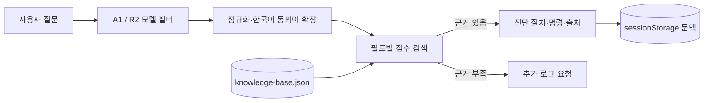

# Yahboom A1·R2 ROS 2 Troubleshooting Chatbot

Yahboom ROSMASTER A1과 R2를 개발하며 기록한 실제 증상, 진단 명령, 해결 과정과 검증 상태를 검색하는 한국어 기술지원 챗봇입니다. 질문은 브라우저 안에서 정적 JSON 지식베이스와 대조되며, 외부 AI API나 유료 검색 서비스로 전송되지 않습니다.

> **바로 사용하기:** [https://elyj27801-hub.github.io/yahboom-a1-r2-chatbot/](https://elyj27801-hub.github.io/yahboom-a1-r2-chatbot/)

## 개발 목적

ROS 2 로봇 문제는 같은 오류 문구라도 USB 장치 순서, ROS 배포판, 센서 드라이버와 작업공간에 따라 원인이 달라집니다. 이 프로젝트는 A1과 R2의 환경을 분리하고, 확인된 사실과 진단 가설을 구별하여 다음 순서로 안내하는 것을 목표로 합니다.

**증상 → 가능한 원인 → 안전한 확인 명령 → 결과별 대응 → 정상 동작 확인 → 출처**

## 주요 기능

- A1 12개, R2 20개 경험 기반 지식 항목 검색
- 한국어 자연어, 오류 코드, ROS 토픽 및 장치명 검색
- A1/R2 모델별 검색 범위 분리
- 연속 질문의 최근 문맥과 선택 모델을 브라우저 세션에 유지
- 명령어 원클릭 복사와 Ubuntu 환경 표시
- 검증 상태와 원본 문서·소스 링크 표시
- 근거가 없을 때 답을 생성하지 않는 `not-found` 응답
- PC·모바일 반응형 UI와 키보드 접근성
- 외부 AI API 호출 없음(API 0회)

## A1과 R2 환경 비교

| 구분 | ROSMASTER A1 | ROSMASTER R2 |
|---|---|---|
| OS 기록 | Ubuntu 22.04 기반 | Ubuntu 24.04 |
| ROS 2 | Humble | Jazzy |
| 주 작업공간 | `~/yahboomcar_ros2_ws/software/library_ws`, `~/yahboomcar_ros2_ws/yahboomcar_ws` | `~/sme_ws2` |
| 제어 | `yahboomcar_bringup`, `Ackman_driver_A1` | `sme_node`, Rosmaster_Lib `car_type=5` 기반 노드 |
| 카메라 | NUWA HP60C RGB-D, `ascamera` | USB Camera, OpenCV/V4L2 |
| LiDAR | T-MINI Plus 기록, 실제 드라이버·모델 재확인 필요 | SLAMTEC SLLIDAR C1, `sllidar_ros2` |
| 대표 토픽 | `/cmd_vel`, `/imu/data_raw`, `/scan` | `/cmd_vel`, `/servo/front_cmd`, `/camera/image_raw`, `/image_rect`, `/scan`, `/imu/data_raw` |

장치 번호와 심볼릭 링크는 장비·부팅 시점마다 달라질 수 있습니다. `/dev/ttyUSB0`, `/dev/ttyUSB1`, `/dev/myserial`을 고정 규칙으로 간주하지 않습니다.

자세한 모델별 기록은 [A1 문서](docs/A1.md)와 [R2 문서](docs/R2.md)를 참고하세요.

## 동작 구조



`src/providers/staticProvider.js`가 검색 공급자 인터페이스를 제공하고, `src/search.js`가 모델 필터·동의어 확장·가중치 계산을 수행합니다. 상세 설계는 [ARCHITECTURE.md](docs/ARCHITECTURE.md)에 있습니다.

## 폴더 구조

```text
.
├── index.html
├── styles.css
├── data/
│   └── knowledge-base.json
├── src/
│   ├── app.js
│   ├── search.js
│   └── providers/
│       └── staticProvider.js
└── docs/
    ├── A1.md
    ├── R2.md
    ├── TROUBLESHOOTING.md
    ├── ARCHITECTURE.md
    └── CONTRIBUTING.md
```

## 사용 방법

1. [공개 사이트](https://elyj27801-hub.github.io/yahboom-a1-r2-chatbot/)에 접속합니다.
2. A1 또는 R2를 선택합니다.
3. 증상, 오류 원문, 토픽 또는 장치명을 입력합니다.
4. 표시된 명령의 대상 환경을 확인한 뒤 복사합니다.
5. 결과를 다시 질문에 포함하면 관련 문맥으로 검색을 이어갑니다.

예시 질문:

```text
AS_SDK_OpenCamera ret -82 오류가 발생해
SL_RESULT_OPERATION_TIMEOUT 오류가 발생해
/cmd_vel을 발행했는데 움직이지 않아
Nav2 controller_server가 시작되지 않아
```

## 대표 오류 사례

| 모델 | 사례 | 상태 | 핵심 진단 |
|---|---|---|---|
| A1 | HP60C `uvc_open: Busy`, `ret -82` | 미해결 | 중복 노드, USB/전원, SDK 로그를 분리 확인 |
| A1 | T-MINI Plus `/scan`과 RViz 표시 불일치 | 부분 확인 | `frame_id`, TF, RViz Fixed Frame 확인 |
| R2 | `SL_RESULT_OPERATION_TIMEOUT` | 부분 확인 | 실제 LiDAR 포트, 점유 프로세스, `/scan` 확인 |
| R2 | Nav2 local costmap `width/height` 타입 오류 | 확인됨 | 사용 버전의 정수 파라미터 요구 여부와 lifecycle 확인 |
| R2 | Ackermann 경로 계획·제자리 회전 문제 | 부분 확인 | 차량 운동 제약과 planner/controller 설정 분리 진단 |

전체 진단 순서는 [TROUBLESHOOTING.md](docs/TROUBLESHOOTING.md)를 참고하세요.

## 지식베이스와 검증 상태

각 항목은 모델, 환경, 증상, 키워드, 가능한 원인, 진단 명령, 해결 또는 다음 단계, 검증 방법, 출처와 상태를 가집니다.

| 상태 | 의미 | A1 | R2 |
|---|---|---:|---:|
| `verified` | 해당 환경에서 특정 출력·동작 또는 해결 사례가 확인됨 | 3 | 11 |
| `partially-verified` | 일부 동작·절차만 확인되었고 전체 해결은 미확정 | 4 | 9 |
| `unverified` | 실제 문제 기록은 있으나 최종 원인·해결 검증이 없음 | 5 | 0 |

`verified`는 모든 장비에서의 재현이나 문제 전체의 해결을 보장하지 않습니다. 항목 추가 방법은 [CONTRIBUTING.md](docs/CONTRIBUTING.md)를 참고하세요.

## 기술 스택

- HTML5, CSS3, Vanilla JavaScript ES Modules
- 정적 JSON 지식베이스
- 브라우저 `sessionStorage`, Clipboard API
- GitHub Pages 정적 호스팅
- ROS 2 Humble/Jazzy 프로젝트 경험 기록(실행 환경, 웹사이트 의존성 아님)

## GitHub Pages 배포

GitHub Pages는 `main` 브랜치의 `/(root)`를 게시합니다. HTML의 CSS·JavaScript 경로와 JavaScript의 JSON 경로는 `./` 상대 경로이므로 프로젝트 하위 경로 `/yahboom-a1-r2-chatbot/`에서 동작합니다. 별도 서버, 데이터베이스, Windows 프로세스 또는 API 키가 필요하지 않습니다.

## 향후 계획

- 새 장비·날짜별 재현 결과와 출처 보강
- 검색 품질 회귀 테스트와 동의어 사전 개선
- 지식 항목 스키마 검증 자동화
- 접근성·모바일 사용성 지속 점검
- 미해결 사례의 실제 장비 검증 후 상태 갱신

AI 답변 기능, 서버 API, 사용자 계정, 원격 장비 제어는 현재 구현되어 있지 않습니다.

## 한계와 안전 주의사항

- 이 사이트는 진단 자료를 검색할 뿐 Jetson, 모터, MCU 또는 ROS 2 노드에 명령을 실행하지 않습니다.
- 모터·조향 시험 전에는 바퀴를 지면에서 띄우고 비상 정지 수단을 준비하세요.
- `sudo`, udev, PWM, 장치 권한 변경은 시스템에 영향을 줄 수 있으므로 장비 관리자와 검토하세요.
- 포트 번호, 카메라 인덱스, ROS_DOMAIN_ID와 파일 경로는 현장 값을 확인해야 합니다.
- 미해결 항목은 진단 순서만 제공하며 해결 완료로 간주하면 안 됩니다.
- 프로젝트에는 라이선스가 명시되어 있지 않습니다. 별도 허가 없이 사용·재배포 조건을 추정하지 마세요.

