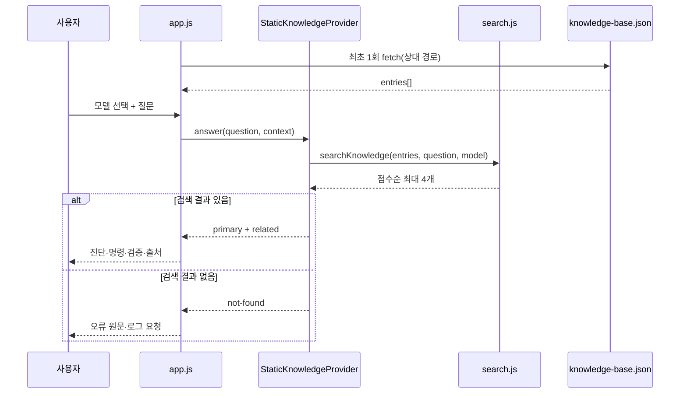

# 웹 챗봇 아키텍처

[README로 돌아가기](../README.md) · [기여 방법](CONTRIBUTING.md)

## 설계 원칙

- **Static-first:** HTML, CSS, ES Modules와 JSON만 사용합니다.
- **Local search:** 질문은 브라우저 안에서 처리합니다.
- **Model isolation:** A1과 R2를 검색 전에 분리합니다.
- **Evidence first:** 저장된 항목만 답하고 근거가 없으면 추가 로그를 요청합니다.
- **No secret:** API 키와 서버 측 비밀정보가 필요하지 않습니다.

## 구성 요소

| 파일 | 역할 |
|---|---|
| `index.html` | 시맨틱 UI, 모델 선택, 채팅 입력, 접근성 레이블 |
| `styles.css` | 데스크톱·모바일 반응형 레이아웃과 상태 표시 |
| `src/app.js` | 상태 관리, 이벤트, 답변 DOM, 복사 버튼, JSON 로딩 |
| `src/search.js` | 정규화, 동의어 확장, 가중치 검색, 결과 제한 |
| `src/providers/staticProvider.js` | 검색 공급자 인터페이스와 not-found 응답 |
| `data/knowledge-base.json` | 32개 구조화 지식 항목 |

## 데이터 흐름



네트워크 요청은 정적 사이트의 `./data/knowledge-base.json` 로딩뿐입니다. 질문이나 세션 내용은 외부 서비스로 전송하지 않습니다.

## 검색 로직

1. Unicode NFKC와 소문자로 질문을 정규화합니다.
2. 한 글자·조사·일반 오류 표현 등 stop word를 제외합니다.
3. LiDAR/라이다, ArUco/마커, 차선/lane 같은 동의어 그룹을 확장합니다.
4. 선택 모델과 일치하는 항목만 남깁니다.
5. 제목 7점, 증상 5점, 키워드 4점, 원인 2점, 환경 1점으로 계산합니다.
6. 긴 키워드의 질문 내 직접 일치에는 10점을 더합니다.
7. `그래도`, `그럼`, `결과`로 시작하는 후속 질문은 직전 항목에 8점을 더합니다.
8. 5점 미만은 제외하고 최대 4개를 반환합니다.

이 방식은 의미 임베딩이 아니라 규칙 기반 검색입니다. 표현이 지식베이스 키워드·동의어와 멀면 결과를 놓칠 수 있습니다.

## 상태와 세션

`sessionStorage`의 `yahboom-support-session-v1` 키에 다음 값을 저장합니다.

- 선택 모델
- 최근 텍스트 메시지 최대 12개
- 직전 지식 항목 ID와 제목

세션은 브라우저 탭 범위이며 서버 데이터베이스나 회원 계정이 없습니다. 구조화 답변 카드는 새로고침 후 완전 복원되지 않고 텍스트 기록과 검색 문맥만 유지됩니다.

## 안전한 렌더링

- 사용자 질문과 지식 항목은 `textContent` 또는 text node로 렌더링합니다.
- 출처 URL만 anchor의 `href`에 사용하고 새 탭에는 `rel="noreferrer"`를 적용합니다.
- 명령 복사는 Clipboard API를 사용하며 실패 시 DOM 선택으로 대체합니다.
- 검색 결과가 없으면 일반 해법을 생성하지 않습니다.

## GitHub Pages 경로

사이트 주소는 다음 프로젝트 하위 경로입니다.

```text
https://elyj27801-hub.github.io/yahboom-a1-r2-chatbot/
```

모든 실행 자산은 `./styles.css`, `./src/app.js`, `./data/knowledge-base.json` 같은 상대 경로입니다. 따라서 `main` 브랜치 `/(root)` 배포에서 저장소 하위 경로를 유지합니다.

## 확장 경계

`StaticKnowledgeProvider.answer(question, context)` 계약을 유지하면 다른 공급자를 구현할 수 있지만, 현재 AI 공급자는 없습니다. 향후 AI를 추가한다면 브라우저에 비밀키를 넣어서는 안 되며 서버 프록시, 인증, 요청 제한, 캐시와 비용 상한이 필요합니다.

